<!--
  GitHub Profile README
  Author: MitakaP
  Theme: Purple Cyber Developer
-->

<!-- ==================== HEADER ==================== -->

<div align="center">


<a href="https://git.io/typing-svg">
  
</a>

<br/>

<a href="https://github.com/MitakaP" target="_blank" rel="noopener noreferrer">
  
</a>
<a href="https://www.linkedin.com/in/dimitar-peltekov" target="_blank" rel="noopener noreferrer">
  
</a>
<a href="mailto:dspeltekov03@gmail.com" target="_blank" rel="noopener noreferrer">
  
</a>
<a href="https://www.instagram.com/mitaka_p" target="_blank" rel="noopener noreferrer">
  
</a>

</div>

---

<!-- ==================== ABOUT ME ==================== -->

## 👨‍💻 About Me

```yaml
name: MitakaP
role: Software Developer
education: Software Technology and Design
interests:
  - Backend Development
  - Frontend Development
  - DevOps and Automation
  - Linux and Server Management
currently_learning:
  - C++ and Unreal Engine 5
  - Linux
  - CI/CD and Containerization
```

- 💻 University student passionate about software development.
- 🌱 Exploring **C++ and Unreal Engine 5**.
- 🐧 Learning **Linux**, server management and automation.
- ⚙️ Interested in backend systems and scalable applications.
- 🚀 Exploring **Docker, Jenkins, Terraform and CI/CD**.
- 🎮 Building console games and full-stack web applications.

---

<!-- ==================== TECH STACK ==================== -->

## 🛠️ Tech Stack

### Programming Languages

<p align="center">
  
</p>

### Frameworks & Databases

<p align="center">
  
</p>

### DevOps & Tools

<p align="center">
  
</p>

---

<!-- ==================== FEATURED PROJECTS ==================== -->

## 🚀 Featured Projects

<table>
<tr>
<td width="50%">
<h3 align="center">🎬 CinemaWorldWebsite</h3>
<div align="center">
<a href="https://github.com/MitakaP/CinemaWorldWebsite" target="_blank" rel="noopener noreferrer">

</a>
<p>Responsive cinema website for movie listings and reservations.</p>
<p><code>HTML</code> <code>CSS</code> <code>JavaScript</code></p>
</div>
</td>

<td width="50%">
<h3 align="center">🎟️ Event Platform</h3>
<div align="center">
<a href="https://github.com/MitakaP/Event-Management-Website---Django-Project" target="_blank" rel="noopener noreferrer">

</a>
<p>Full-featured Django application for managing and attending events.</p>
<p><code>Python</code> <code>Django</code> <code>HTML</code></p>
</div>
</td>
</tr>

<tr>
<td width="50%">
<h3 align="center">🏰 Storm The Castle</h3>
<div align="center">
<a href="https://github.com/MitakaP/Storm-The-Castle-Game" target="_blank" rel="noopener noreferrer">

</a>
<p>Console game developed using C#.</p>
<p><code>C#</code></p>
</div>
</td>

<td width="50%">
<h3 align="center">✂️ Rock Paper Scissors</h3>
<div align="center">
<a href="https://github.com/MitakaP/RockPaperScissorsByDimitar" target="_blank" rel="noopener noreferrer">

</a>
<p>A simple Python console game.</p>
<p><code>Python</code></p>
</div>
</td>
</tr>
</table>

---

<!-- ==================== GITHUB STATISTICS ==================== -->

## 📊 GitHub Analytics

<div align="center">



<br/>



</div>

---


<!-- ==================== CONTRIBUTIONS ==================== -->

## 🐍 Contribution Activity

<div align="center">


</div>

---


<!-- ==================== TERMINAL OUTRO ==================== -->

<h2 align="center">💻 Developer Terminal</h2>

<div align="center">


<br/>

<a href="https://github.com/MitakaP/CinemaWorldWebsite" target="_blank" rel="noopener noreferrer">CinemaWorld</a>
&nbsp; • &nbsp;
<a href="https://github.com/MitakaP/Event-Management-Website---Django-Project" target="_blank" rel="noopener noreferrer">Event Platform</a>
&nbsp; • &nbsp;
<a href="https://github.com/MitakaP/Storm-The-Castle-Game" target="_blank" rel="noopener noreferrer">Storm The Castle</a>
&nbsp; • &nbsp;
<a href="https://github.com/MitakaP/RockPaperScissors" target="_blank" rel="noopener noreferrer">Rock Paper Scissors</a>

<br/><br/>


</div>

<br/>

<div align="center">


</div>

<br/><br/>

### 💜 Thanks for visiting!

*Always learning. Always building. Always improving.*


</div>
